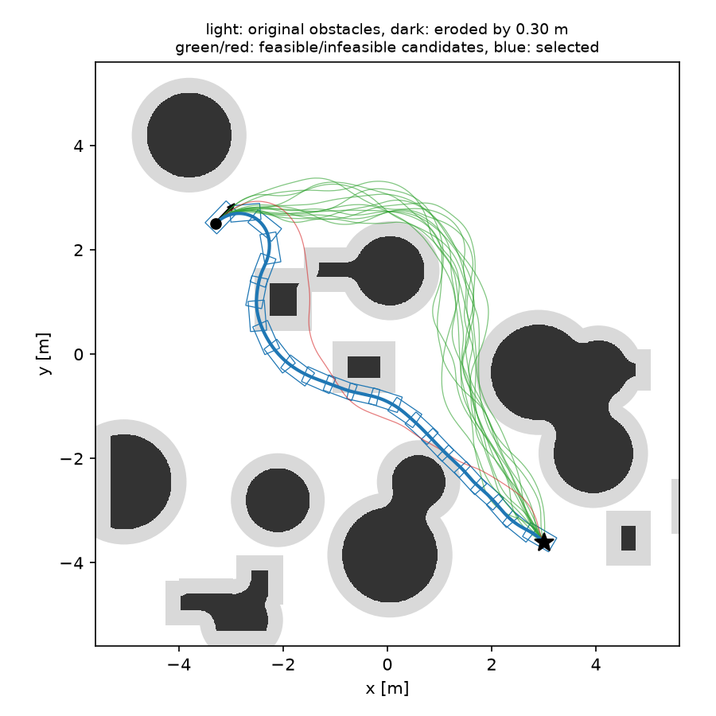

**English** | [简体中文](README.zh-CN.md)

# CorrectFlow: flow-matching car planner (minimal demo)

Plans a collision-free, curvature-bounded route for a forward-only car between a start
pose and a goal position on a 11.2 m x 11.2 m map. A conditional flow-matching network
proposes 16 routes in 5 steps; an endpoint Levenberg-Marquardt (LM) step and a constrained
Gauss-Newton collision repair finish them; an exact check picks the shortest feasible one.



This repository holds the inference code, three sets of trained weights, six example
queries and the full test set (maps and query lists). Training code is not included.

> The method comes from an unpublished manuscript (master's thesis work). Comments in the
> code cite its equation and section labels (`eq:...`, `sec:...`); they are kept for
> traceability and can be ignored.

## Files

| file | content |
|---|---|
| `demo.py` | (1) reads the queries, runs steps 2-5, prints a summary |
| `model.py` | (2) flow-matching network and guided sampling of 16 candidates |
| `postprocess.py` | (3) endpoint LM and constrained Gauss-Newton collision correction |
| `check.py` | (4) exact feasibility check; the shortest feasible route is kept |
| `plot.py` | (5) figure `out/<query>.png` |
| `config.py` | all constants (vehicle, pixels and images, network, figure) and torch settings (TF32 off) |
| `common.py` | route geometry and eroded maps, shared by all steps |
| `weights/flow_seed{0,1,2}.pt` | trained weights, three training seeds (5.5 MB each, 1.37 M parameters) |
| `examples/*.json` | 6 test queries, one map and one query per file (NIRRT `random_2d` test split) |
| `data/envs.json` | the 125 test maps of NIRRT `random_2d` |
| `data/test_hw_2000_nf.csv` | the 2,000 test queries used for evaluation |
| `data/test_hw_all.csv` | all 21,956 test queries the 2,000 were drawn from |
| `results/` | success rates on both test lists, figures of all failed cases, 50 random samples |

## Install

```bash
pip install -r requirements.txt
```

Tested with Python 3.11, torch 2.6.0, numpy 2.4.6, scipy 1.17.1, matplotlib 3.11.2.

## Run

```bash
python demo.py                                                # GPU (default), seed-0 weights
python demo.py --device cpu --weights weights/flow_seed1.pt   # CPU
python demo.py --queries examples/test_hw_2000_250.json       # one query only
python demo.py --list data/test_hw_2000_nf.csv --index 250 777   # rows of a query list
python demo.py --list data/test_hw_2000_nf.csv --no-plot         # the whole test set
```

| option | default | meaning |
|---|---|---|
| `--device` | `cuda` | `cuda` or `cpu` |
| `--weights` | `weights/flow_seed0.pt` | which training seed to load |
| `--queries` | `examples` | one or more query files, or directories of them (format below) |
| `--list` | none | query list (CSV, see Data); replaces `--queries` |
| `--maps` | `data/envs.json` | map file that `map_id` of the list points into |
| `--index` | all rows | rows of the list to plan, 0-based |
| `--no-plot` | off | do not write figures |
| `--samples` | `16` | candidates per query |
| `--seed` | `0` | random seed of the sampler |

Output of the CPU command above:

```
warm-up: 6 queries, 21.09s, not timed
   test_hw_2000[0]  feasible 16/16  plan  1.10s  length 5.62 m  endpoint 0.010 mm  max kappa 1.6327
   test_hw_2000[1]  feasible 16/16  plan  1.17s  length 4.17 m  endpoint 0.598 mm  max kappa 1.2998
 test_hw_2000[250]  feasible 16/16  plan  1.44s  length 11.34 m  endpoint 0.001 mm  max kappa 1.2846
 test_hw_2000[777]  feasible 16/16  plan  1.31s  length 6.65 m  endpoint 0.000 mm  max kappa 1.1442
test_hw_2000[1234]  feasible 16/16  plan  1.32s  length 7.59 m  endpoint 0.052 mm  max kappa 1.6492
test_hw_2000[1999]  feasible 16/16  plan  1.11s  length 6.21 m  endpoint 0.170 mm  max kappa 1.6590
solved 6/6 queries, plan time mean 1.24s max 1.44s
```

Each line gives the number of candidates that pass the exact check, the planning time, and
the length, endpoint error and largest curvature (1/m) of the selected route. One figure
per query is written to `out/`: original obstacles in light grey, eroded obstacles in dark
grey, feasible candidates in green, infeasible ones in red, the selected route in blue
with the body outline.

### Timing

The printed `plan` time covers `plan()` in `demo.py` only (sampling, endpoint LM, collision
correction), not the exact check or the figure. Before timing, `demo.py` plans the first
queries (at most 6) once untimed: the first CUDA call and the first `vmap` / cuSOLVER call in the collision
correction each cost about 1 s once.

* GPU: about 0.1-0.25 s per query. On the 2,000-query held-out test set the mean was
  0.19 s and the maximum 0.49 s on an RTX 3080, also after a warm-up.
* CPU: about 0.5-1.5 s per query with `OMP_NUM_THREADS=4`, depending on the machine. The
  listing above was taken on a shared node, so its times are on the slow side.

## Your own queries

Each query file holds one map and one query:

```json
{
  "map": {
    "env_dims": [224, 224],
    "rectangle_obstacles": [[135, 13, 17, 20], [133, 73, 16, 16]],
    "circle_obstacles": [[128, 86, 23], [44, 24, 22]]
  },
  "query": {
    "name": "my_query",
    "start": [-2.4, 2.75, -0.314],
    "goal": [2.79, 0.28]
  }
}
```

Pass it with `--queries my_query.json`; several files or a directory also work. The
figure is written to `out/<name>.png`.

* `start` and `goal` are in metres with the origin at the map centre, x to the right and
  y up, so both coordinates lie in [-5.6, 5.6]. `yaw` is in radians, counter-clockwise
  from the x axis. The goal has no heading.
* Obstacles use the NIRRT pixel convention: 0.05 m per pixel on a 224 x 224 image, origin
  at the top-left corner, y down. A rectangle is `[left, top, width, height]`, a circle
  `[centre x, centre y, radius]`.

## Setting (read before comparing numbers)

* Vehicle: rear-axle pose `[x, y, yaw]`, rectangle body 0.58 m x 0.31 m, centre 0.17145 m
  ahead of the rear axle, curvature bound 1.7495 1/m (wheelbase 0.33 m, 30 deg steering).
* Route: 64 equal-length constant-curvature arcs, so the curvature bound holds by construction.
* Map: the NIRRT rectangles and circles are merged and then **eroded (shrunk) by 0.30 m**.
  The supervision paths come from SST (Stable Sparse RRT) with a point robot, and shrinking
  the obstacles is what leaves room for the rectangular body. All checks use the eroded
  map; the map border is not eroded.
* Feasible = no curvature violation, endpoint error at most 1 mm, and no body overlap with
  the eroded obstacles or the border, checked every 0.02 m on a 1 cm grid.

## Scope

The weights were trained for one setting only: this vehicle, forward motion only, static
11.2 m x 11.2 m maps of the NIRRT `random_2d` kind with obstacles eroded by 0.30 m. Other
map sizes, obstacle styles, vehicles or reversing are outside what the network has seen,
and no claim is made about them.

## Data

Queries come in two forms. `examples/` has six self-contained files (one map and one query
each) for a first look. `data/` has the full test set as one map file and two query lists;
a list row refers to its map by `map_id`.

| file | rows | content |
|---|---|---|
| `data/envs.json` | 125 maps | test maps of NIRRT `random_2d`, unchanged from the NIRRT release |
| `data/test_hw_2000_nf.csv` | 2,000 | the test queries used for evaluation, drawn from the list below; all 125 maps occur |
| `data/test_hw_all.csv` | 21,956 | every start/goal condition of the test split that has a known solution on the eroded map |

**`envs.json`** is a list; entry `i` is map `i`. Each entry has `env_dims`,
`rectangle_obstacles` and `circle_obstacles` in the pixel convention described under
"Your own queries". The fields `start`, `goal` and `astar_time` belong to NIRRT and are
not used here.

**The two lists** share these columns:

| column | meaning |
|---|---|
| `condition_index` | running number of the condition in the test split (0 to 24,965) |
| `map_id` | position of the map in `envs.json` (0 to 124) |
| `pair_id`, `angle` | start/goal pair of that map, and start heading in degrees |
| `start_x_m`, `start_y_m`, `start_yaw_rad` | start pose, metres and radians, origin at the map centre |
| `goal_x_m`, `goal_y_m` | goal position |

The test split has 24,966 conditions. A condition is kept in `test_hw_all.csv` when the
body, following its SST reference path, does not touch the eroded map, which leaves
21,956; this guarantees that every listed query has a solution. `test_hw_2000_nf.csv` is
a fixed random draw of 2,000 of them. The six files in `examples/` are its rows 0, 1, 250,
777, 1234 and 1999.

`--index` counts data rows of the CSV from 0 (the header is not counted); it is not
`condition_index`. On this test set the method solved about 99.9 % of the 2,000 queries
for each of the three weight seeds. Planning all 2,000 takes a few minutes on a GPU and
considerably longer on a CPU; use `--no-plot`.

The maps come from the dataset released with Neural Informed RRT* (NIRRT*):
https://github.com/tedhuang96/nirrt_star

## Results

### Reported evaluation

Numbers of the original evaluation, three weight seeds, 16 candidates per query. The
success rate counts queries with at least one feasible candidate; the candidate columns
are over all 16 candidates of all queries; the length ratio is the selected route length
divided by the length of the SST reference path, over solved queries.

| test set | queries | success % (seed 0 / 1 / 2) | mean | failed (seed 0 / 1 / 2) | candidate success % | candidate collision % | curvature violation % | length ratio |
|---|---:|---|---:|---|---:|---:|---:|---:|
| `test_hw_2000_nf` | 2,000 | 99.90 / 99.95 / 99.95 | 99.93 | 2 / 1 / 1 | 95.96 | 4.03 | 0 | 0.92 |
| `test_hw_all` | 21,956 | 99.84 / 99.84 / 99.90 | 99.86 | 36 / 35 / 21 | 95.92 | 4.07 | 0 | 0.93 |

Runtime on `test_hw_2000_nf`: 0.19 s mean and 0.49 s maximum per query on an RTX 3080.

### Re-run with this repository

The same two lists planned again with the code and weights of this repository, one query
at a time with the default sampling seed, mostly on GTX 1080 Ti (shared nodes). Per-seed
numbers are in `results/success_rates.csv`.

| test set | queries | success % (seed 0 / 1 / 2) | mean | failed (seed 0 / 1 / 2) | candidate success % | plan time, mean s |
|---|---:|---|---:|---|---:|---:|
| `test_hw_2000_nf` | 2,000 | 99.95 / 99.95 / 99.95 | 99.95 | 1 / 1 / 1 | 95.99 | 0.21 |
| `test_hw_all` | 21,956 | 99.85 / 99.90 / 99.91 | 99.88 | 33 / 23 / 20 | 95.96 | 0.21 |

The original evaluation planned four queries per batch with a different noise stream, so
single failures differ between the two tables; the rates agree to within 0.05 percentage
points. The slowest single query of the re-run took 1.13 s.

### Failed cases

`results/failed/` has one figure for every failed (query, weight seed) pair of the re-run
and the table `failed.csv`:

* `test_hw_all/`: 76 figures, 51 distinct queries. 34 of them fail with one seed, 9 with
  two and 8 with all three.
* `test_hw_2000_nf/`: the 3 of them that belong to the 2,000-query list (rows 552, 1088
  and 1909, one seed each).

In every failed case all 16 candidates collide with the eroded map; no candidate violates
the curvature bound, and 2 of the 1,216 candidates also miss the goal by more than 1 mm.
35 of the 76 failures are on map 116. A figure can be reproduced with
`python demo.py --list data/test_hw_all.csv --index <row> --weights weights/flow_seed<s>.pt`
on a GPU; on a CPU the floating-point results differ slightly and a borderline case may
come out solved.

### More candidates

A query fails when none of its 16 candidates is feasible. About 96 % of all candidates are
feasible, so a failure is a query on which feasible candidates are rare, and drawing more
candidates (`--samples`) solves most of them.

* Original evaluation: the 4 failed (query, weight seed) pairs of `test_hw_2000_nf` are
  all solved with 100 candidates. With 100 candidates for every query the success rate is
  99.98 % and the mean runtime rises from 0.19 s to 0.31 s.
* Re-run, `test_hw_2000_nf`: rows 552 and 1088 are solved with `--samples 100` (10 and 2
  feasible candidates of 100). Row 1909 is not solved by that batch of 100, but by another
  one (`--weights weights/flow_seed1.pt --samples 100 --seed 2`). The figures `*_100cand.png` in
  `results/failed/test_hw_2000_nf/` show the three queries with 100 candidates.
* Re-run, `test_hw_all`: 56 of the 76 failures are solved with 100 candidates, and 69
  within 500 (five batches of 100, sampling seeds 0 to 4). The other 7 stay unsolved; they
  are on maps 111 and 116. `failed.csv` lists the counts.

```bash
python demo.py --list data/test_hw_2000_nf.csv --index 552 --samples 100
```

On the failed queries, planning with 100 candidates took 0.58 s on average on a GTX 1080 Ti.

### Random samples

`results/samples_50/` holds the output for 50 rows of `data/test_hw_2000_nf.csv`, drawn at
random with a fixed seed and not selected by outcome: one figure per query and the printed
lines in `summary.txt` (seed-0 weights, CPU). All 50 are solved; in 15 of them some of the
16 candidates are infeasible (red in the figures) and the route is chosen among the rest.
