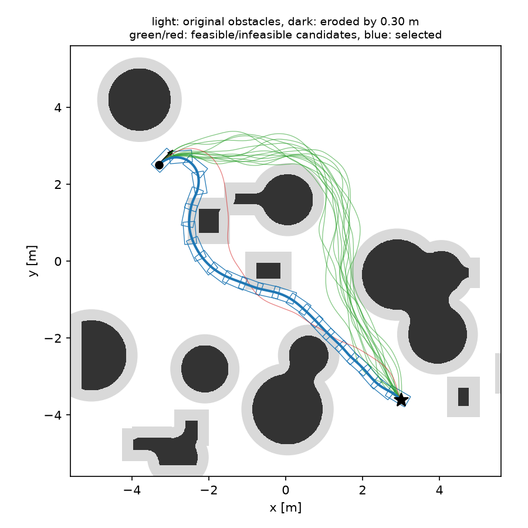

[English](README.md) | **简体中文**

# CorrectFlow：基于流匹配的类车路径规划（最小演示）

在 11.2 m × 11.2 m 的地图上，为只能前进的类车机器人规划一条从起点位姿到终点位置、
无碰撞且满足曲率上限的路线。条件流匹配网络用 5 步生成 16 条候选路线；随后用
Levenberg-Marquardt（LM）修正终点，用带约束的 Gauss-Newton 修正碰撞；最后经精确判定，
取可行候选中最短的一条。



本仓库包含推理代码、三组训练好的权重、六个示例问题，以及完整的测试集（地图与问题清单）。
不包含训练代码。

> 方法出自一份尚未发表的稿件（硕士论文工作）。代码注释中引用了该稿件的公式与章节标签
> （`eq:...`、`sec:...`），保留它们只是为了便于追溯，阅读时可以忽略。

## 文件

| 文件 | 内容 |
|---|---|
| `demo.py` | （1）读取问题，执行第 2–5 步，打印汇总 |
| `model.py` | （2）流匹配网络，带引导地采样 16 条候选 |
| `postprocess.py` | （3）终点 LM 修正与带约束的 Gauss-Newton 碰撞修正 |
| `check.py` | （4）精确可行性判定；保留最短的可行路线 |
| `plot.py` | （5）画图，输出 `out/<问题名>.png` |
| `config.py` | 全部常量（车辆、像素与图像、网络、画图）和 torch 设置（关闭 TF32） |
| `common.py` | 路线几何与腐蚀地图，各步骤共用 |
| `weights/flow_seed{0,1,2}.pt` | 训练好的权重，三个训练种子（各 5.5 MB，137 万参数） |
| `examples/*.json` | 6 个测试问题，每个文件一张地图加一个问题（NIRRT `random_2d` 测试集） |
| `data/envs.json` | NIRRT `random_2d` 的 125 张测试地图 |
| `data/test_hw_2000_nf.csv` | 评测所用的 2,000 个测试问题 |
| `data/test_hw_all.csv` | 全部 21,956 个测试问题，上面的 2,000 个从中抽出 |
| `results/` | 两份测试清单上的成功率、全部失败案例的图、50 个随机样例 |

## 安装

```bash
pip install -r requirements.txt
```

已在 Python 3.11、torch 2.6.0、numpy 2.4.6、scipy 1.17.1、matplotlib 3.11.2 下测试。

## 运行

```bash
python demo.py                                                # GPU（默认），种子 0 权重
python demo.py --device cpu --weights weights/flow_seed1.pt   # CPU
python demo.py --queries examples/test_hw_2000_250.json       # 只跑一个问题
python demo.py --list data/test_hw_2000_nf.csv --index 250 777   # 跑清单中的若干行
python demo.py --list data/test_hw_2000_nf.csv --no-plot         # 跑整个测试集
```

| 参数 | 默认值 | 含义 |
|---|---|---|
| `--device` | `cuda` | `cuda` 或 `cpu` |
| `--weights` | `weights/flow_seed0.pt` | 加载哪个训练种子的权重 |
| `--queries` | `examples` | 一个或多个问题文件，也可以是存放它们的目录（格式见下文） |
| `--list` | 无 | 问题清单（CSV，见“数据”一节）；给出后取代 `--queries` |
| `--maps` | `data/envs.json` | 地图文件，清单中的 `map_id` 指向其中的地图 |
| `--index` | 全部行 | 要规划的清单行号，从 0 开始 |
| `--no-plot` | 关 | 不输出图片 |
| `--samples` | `16` | 每个问题的候选数 |
| `--seed` | `0` | 采样的随机种子 |

上面 CPU 命令的输出：

```
warm-up: 6 queries, 21.09s, not timed
   test_hw_2000[0]  feasible 16/16  plan  1.10s  length 5.62 m  endpoint 0.010 mm  max kappa 1.6327
   test_hw_2000[1]  feasible 16/16  plan  1.17s  length 4.17 m  endpoint 0.598 mm  max kappa 1.2998
 test_hw_2000[250]  feasible 16/16  plan  1.44s  length 11.34 m  endpoint 0.001 mm  max kappa 1.2846
 test_hw_2000[777]  feasible 16/16  plan  1.31s  length 6.65 m  endpoint 0.000 mm  max kappa 1.1442
test_hw_2000[1234]  feasible 16/16  plan  1.32s  length 7.59 m  endpoint 0.052 mm  max kappa 1.6492
test_hw_2000[1999]  feasible 16/16  plan  1.11s  length 6.21 m  endpoint 0.170 mm  max kappa 1.6590
solved 6/6 queries, plan time mean 1.24s max 1.44s
```

每行依次是：通过精确判定的候选数、规划耗时，以及被选中路线的长度、终点误差和最大曲率
（1/m）。每个问题在 `out/` 下输出一张图：浅灰是原始障碍，深灰是腐蚀后的障碍，绿色是
可行候选，红色是不可行候选，蓝色是被选中的路线及车体轮廓。

### 耗时

打印的 `plan` 耗时只包含 `demo.py` 中的 `plan()`（采样、终点 LM、碰撞修正），不包含精确
判定和画图。计时之前，`demo.py` 会先不计时地规划前几个问题（最多 6 个）：第一次 CUDA
调用，以及碰撞修正中第一次 `vmap` / cuSOLVER 调用，各有约 1 s 的一次性开销。

* GPU：每个问题约 0.1–0.25 s。在 2,000 个问题的留出测试集上，RTX 3080 的平均耗时为
  0.19 s、最大 0.49 s，同样是预热之后的数字。
* CPU：`OMP_NUM_THREADS=4` 时每个问题约 0.5–1.5 s，取决于机器。上面那段输出是在共享节点
  上得到的，耗时偏慢。

## 使用自己的问题

每个问题文件包含一张地图和一个问题：

```json
{
  "map": {
    "env_dims": [224, 224],
    "rectangle_obstacles": [[135, 13, 17, 20], [133, 73, 16, 16]],
    "circle_obstacles": [[128, 86, 23], [44, 24, 22]]
  },
  "query": {
    "name": "my_query",
    "start": [-2.4, 2.75, -0.314],
    "goal": [2.79, 0.28]
  }
}
```

用 `--queries my_query.json` 传入；也可以传多个文件或一个目录。图片输出到
`out/<name>.png`。

* `start` 和 `goal` 的单位是米，原点在地图中心，x 向右、y 向上，因此两个坐标都在
  [-5.6, 5.6] 之内。`yaw` 的单位是弧度，从 x 轴起逆时针为正。终点不指定朝向。
* 障碍采用 NIRRT 的像素约定：224 × 224 的图像，每像素 0.05 m，原点在左上角，y 向下。
  矩形为 `[左, 上, 宽, 高]`，圆为 `[圆心 x, 圆心 y, 半径]`。

## 设定（比较数字之前请先阅读）

* 车辆：后轴位姿 `[x, y, yaw]`，矩形车体 0.58 m × 0.31 m，车体中心在后轴前方
  0.17145 m，曲率上限 1.7495 1/m（轴距 0.33 m，转向角 30°）。
* 路线：64 段等长的常曲率圆弧，因此曲率上限由构造保证。
* 地图：NIRRT 的矩形与圆先合并，再**向内腐蚀（缩小）0.30 m**。监督路径来自点机器人的
  SST（Stable Sparse RRT），缩小障碍是为了给矩形车体留出空间。所有判定都使用腐蚀后的
  地图；地图边界不腐蚀。
* 可行 = 没有曲率违反、终点误差不超过 1 mm、车体与腐蚀后的障碍及边界均不重叠；沿路线
  每 0.02 m 在 1 cm 栅格上检查一次。

## 适用范围

权重只针对一种设定训练：这一种车辆、只前进、NIRRT `random_2d` 类型的 11.2 m × 11.2 m
静态地图、障碍腐蚀 0.30 m。其他地图尺寸、障碍形态、车辆或倒车都超出了网络见过的范围，
本仓库对这些情形不作任何保证。

## 数据

问题有两种形式。`examples/` 中是六个自包含的文件（各含一张地图和一个问题），便于快速
上手。`data/` 中是完整的测试集，由一个地图文件和两份问题清单组成；清单的每一行通过
`map_id` 指向对应的地图。

| 文件 | 行数 | 内容 |
|---|---|---|
| `data/envs.json` | 125 张地图 | NIRRT `random_2d` 的测试地图，与 NIRRT 发布的文件相同，未作改动 |
| `data/test_hw_2000_nf.csv` | 2,000 | 评测所用的测试问题，从下面的清单中抽出；覆盖全部 125 张地图 |
| `data/test_hw_all.csv` | 21,956 | 测试集中所有在腐蚀地图上已知有解的起终点条件 |

**`envs.json`** 是一个列表，第 `i` 项就是地图 `i`。每项包含 `env_dims`、
`rectangle_obstacles` 和 `circle_obstacles`，像素约定见“使用自己的问题”一节。字段
`start`、`goal` 和 `astar_time` 属于 NIRRT，这里不使用。

**两份清单**的列相同：

| 列 | 含义 |
|---|---|
| `condition_index` | 该条件在测试集中的流水号（0 到 24,965） |
| `map_id` | 地图在 `envs.json` 中的位置（0 到 124） |
| `pair_id`、`angle` | 该地图上的第几对起终点，以及起点朝向（度） |
| `start_x_m`、`start_y_m`、`start_yaw_rad` | 起点位姿，单位为米和弧度，原点在地图中心 |
| `goal_x_m`、`goal_y_m` | 终点位置 |

测试集共有 24,966 个条件。若车体沿 SST 参考路径行驶时不碰到腐蚀后的地图，该条件就保留在
`test_hw_all.csv` 中，共 21,956 个；这保证了清单中的每个问题都有解。
`test_hw_2000_nf.csv` 是从中固定随机抽取的 2,000 个。`examples/` 中的六个文件对应它的
第 0、1、250、777、1234、1999 行。

`--index` 按 CSV 的数据行从 0 计数（不含表头），不是 `condition_index`。在这个测试集上，
三个权重种子各自解出了 2,000 个问题中的约 99.9 %。规划全部 2,000 个问题在 GPU 上需要
几分钟，在 CPU 上要长得多；请加 `--no-plot`。

地图来自随 Neural Informed RRT*（NIRRT*）发布的数据集：
https://github.com/tedhuang96/nirrt_star

## 结果

### 原评测的指标

以下是当时评测的数字：三个权重种子，每个问题 16 条候选。成功率指至少有一条可行候选的问题
所占比例；候选相关的两列以全部问题的全部 16 条候选为分母；路长比是被选中路线的长度除以
SST 参考路径的长度，只在解出的问题上统计。

| 测试组 | 问题数 | 成功率 %（种子 0 / 1 / 2） | 均值 | 失败数（种子 0 / 1 / 2） | 单候选成功率 % | 单候选碰撞率 % | 曲率违反率 % | 路长比 |
|---|---:|---|---:|---|---:|---:|---:|---:|
| `test_hw_2000_nf` | 2,000 | 99.90 / 99.95 / 99.95 | 99.93 | 2 / 1 / 1 | 95.96 | 4.03 | 0 | 0.92 |
| `test_hw_all` | 21,956 | 99.84 / 99.84 / 99.90 | 99.86 | 36 / 35 / 21 | 95.92 | 4.07 | 0 | 0.93 |

`test_hw_2000_nf` 上的耗时：RTX 3080 上每个问题平均 0.19 s、最大 0.49 s。

### 用本仓库重跑

用本仓库的代码和权重把同样两份清单重新规划了一遍：逐个问题规划，采样种子用默认值，
大部分在 GTX 1080 Ti（共享节点）上完成。逐种子的数字在 `results/success_rates.csv` 中。

| 测试组 | 问题数 | 成功率 %（种子 0 / 1 / 2） | 均值 | 失败数（种子 0 / 1 / 2） | 单候选成功率 % | 规划耗时均值 s |
|---|---:|---|---:|---|---:|---:|
| `test_hw_2000_nf` | 2,000 | 99.95 / 99.95 / 99.95 | 99.95 | 1 / 1 / 1 | 95.99 | 0.21 |
| `test_hw_all` | 21,956 | 99.85 / 99.90 / 99.91 | 99.88 | 33 / 23 / 20 | 95.96 | 0.21 |

原评测每批规划四个问题，使用的噪声序列也不同，所以两张表里失败的具体问题并不相同；两者
的成功率相差不超过 0.05 个百分点。重跑中最慢的单个问题耗时 1.13 s。

### 失败案例

`results/failed/` 中是重跑里每一个失败的（问题, 权重种子）对应的图，以及汇总表
`failed.csv`：

* `test_hw_all/`：76 张图，涉及 51 个不同的问题。其中 34 个只在一个种子下失败，9 个在
  两个种子下失败，8 个在三个种子下都失败。
* `test_hw_2000_nf/`：其中属于 2,000 条清单的 3 个（第 552、1088、1909 行，各在一个
  种子下失败）。

所有失败案例都是 16 条候选全部与腐蚀地图碰撞；没有候选违反曲率上限，1,216 条候选中另有
2 条终点误差超过 1 mm。76 次失败中有 35 次发生在 116 号地图上。在 GPU 上运行
`python demo.py --list data/test_hw_all.csv --index <行号> --weights weights/flow_seed<s>.pt`
可以复现对应的图；在 CPU 上浮点结果略有差别，处于边界的案例可能会被解出。

### 增加采样次数

一个问题失败，是指它的 16 条候选没有一条可行。全部候选中约 96 % 是可行的，所以失败的问题
只是可行候选很少，多采样一些候选（`--samples`）就能解出其中的大部分。

* 原评测：`test_hw_2000_nf` 上失败的 4 个（问题, 权重种子），改用 100 条候选后全部解出。
  对所有问题都用 100 条候选时，成功率为 99.98 %，平均耗时从 0.19 s 增加到 0.31 s。
* 重跑，`test_hw_2000_nf`：第 552、1088 行用 `--samples 100` 即可解出（100 条候选中分别
  有 10 条和 2 条可行）。第 1909 行在这一批 100 条中没有解出，换一批后解出
  （`--weights weights/flow_seed1.pt --samples 100 --seed 2`）。`results/failed/test_hw_2000_nf/` 中的 `*_100cand.png`
  是这三个问题用 100 条候选时的图。
* 重跑，`test_hw_all`：76 次失败中，56 次用 100 条候选解出，69 次在 500 条以内解出
  （五批各 100 条，采样种子 0 到 4）。其余 7 次仍未解出，都在 111 号和 116 号地图上。
  各案例的条数见 `failed.csv`。

```bash
python demo.py --list data/test_hw_2000_nf.csv --index 552 --samples 100
```

在这些失败的问题上，用 100 条候选规划的平均耗时为 0.58 s（GTX 1080 Ti）。

### 随机样例

`results/samples_50/` 中是 `data/test_hw_2000_nf.csv` 里 50 行的输出。这 50 行用固定种子
随机抽取，没有按结果挑选：每个问题一张图，打印的各行在 `summary.txt` 中（种子 0 权重，
CPU）。50 个问题全部解出；其中 15 个问题的 16 条候选里有一部分不可行（图中红色），路线
从其余候选中选出。
